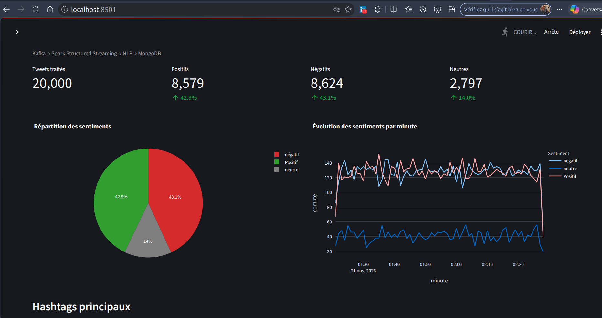

# Analyse des tweets en temps réel

> Pipeline Data Engineering de bout en bout : collecte de tweets en continu, ingestion via Apache Kafka, traitement par Apache Spark Structured Streaming, analyse linguistique, stockage NoSQL et visualisation temps réel.

---

## Sommaire

1. [Présentation du projet](#1-présentation-du-projet)
2. [Architecture technique](#2-architecture-technique)
3. [Technologies utilisées](#3-technologies-utilisées)
4. [Structure du projet](#4-structure-du-projet)
5. [Installation et configuration](#5-installation-et-configuration)
6. [Exécution du pipeline](#6-exécution-du-pipeline)
7. [Données et traitement](#7-données-et-traitement)
8. [Dashboard](#8-dashboard)
9. [Tests et validation](#9-tests-et-validation)
10. [Limites et améliorations](#10-limites-et-améliorations)
11. [Sécurité et bonnes pratiques](#11-sécurité-et-bonnes-pratiques)
12. [Auteur et compétences acquises](#12-auteur-et-compétences-acquises)

---

## 1. Présentation du projet

### Contexte et problème métier

Les organisations ont besoin de suivre en quasi temps réel la perception d'un sujet (marque, produit, mot-clé, hashtag) sur les réseaux sociaux. Le traitement par lots (batch) est inadapté à ce besoin : il introduit une latence de plusieurs heures.

Ce projet implémente un **pipeline de streaming** capable d'ingérer un flux continu de tweets, de les analyser automatiquement, de les stocker dans une base NoSQL et de les restituer dans un tableau de bord rafraîchi automatiquement.

### Objectifs

- Collecter des tweets en continu (via un simulateur reproductible par défaut).
- Transporter le flux via Apache Kafka.
- Traiter le flux avec Apache Spark Structured Streaming.
- Analyser le texte (nettoyage + polarité).
- Stocker les résultats dans MongoDB.
- Visualiser les indicateurs clés via Streamlit.
- Fonctionner **sans compte Twitter/X** grâce à un mode simulation qui passe par **la même architecture** (Kafka → Spark → MongoDB → Dashboard).

### Fonctionnement général

1. Un **producteur Python** publie des tweets dans le topic Kafka `tweets_raw`.
2. Un **job Spark** lit ce topic, nettoie le texte, calcule une polarité, produit un document JSON.
3. Chaque micro-batch est inséré dans la collection MongoDB `analyzed_tweets` (écriture idempotente via `_id = tweet_id`).
4. Le **dashboard Streamlit** interroge MongoDB et se rafraîchit toutes les *N* secondes.

### Cas d'utilisation concrets

- Veille de marque : suivre la tonalité des mentions d'une entreprise.
- Suivi de campagne : observer l'évolution d'un hashtag dans le temps.
- Analyse d'événement : mesurer la réaction du public à une annonce.
- Pédagogie : démonstration d'une architecture de streaming complète.

---

## 2. Architecture technique

### Pipeline

[text](../../../../../..)